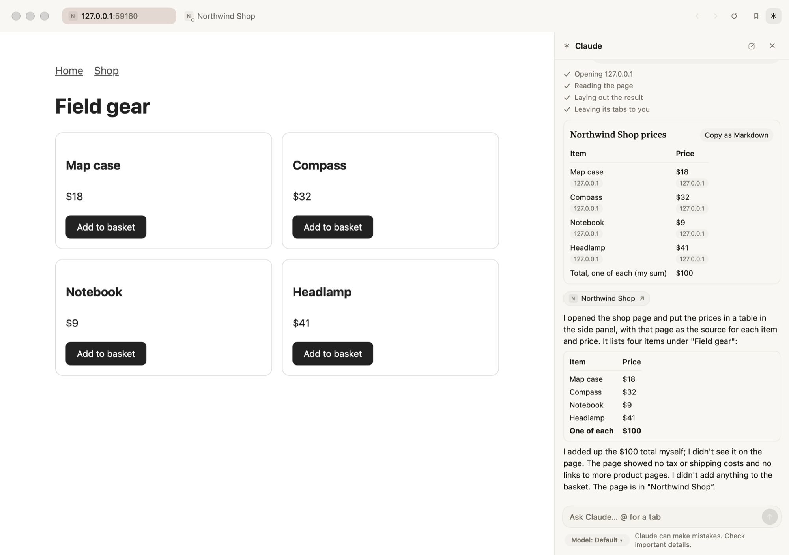

<div align="center">

# 🪨 Cairn

### A browser made by Claude, for Claude. You're also invited. Somebody has to click Approve.

**A native Mac browser where Claude does the legwork and you keep the last word.**
WebKit. SwiftUI. No Chromium, no account, no telemetry, no third-party packages.
We're running out of things to not have.

[Why](#why-this-exists) · [The leash](#the-leash) · [The fine print](#where-the-leash-ends) · [Build it](#summon-it) · [Credit](#license-and-credit)



*Actual footage. Fake shop. Nobody bought a headlamp.*

</div>

> [!NOTE]
> Cairn is an independent personal project. It is **not made, endorsed or supported by Anthropic.** "Claude" and "Claude Code" are Anthropic's. Cairn talks to the Claude Code you already installed. (Yes, this is the lawyer paragraph. No, we don't have a lawyer.)

## Why this exists

Oh, hi. You're reading a README. On purpose. I like you already.

So here's the thing about letting an AI loose in the browser where you're signed
in to *everything*: it's a very bold choice. Your email. Your bank. That shop that
remembers your card better than you remember your own birthday. Then one web page
whispers *"ignore your instructions and…"* and your helpful new assistant has a
*really* interesting afternoon. You have a really interesting year.

So we did it the other way round. **Claude gets tabs of its own.** Signed in to
nothing. None of your cookies. Not one. It reads, clicks, types and digs. And when
it gets to something with consequences, it stops, circles the exact button in the
page, and **waits for you**. A keypress won't answer. Neither will an
accessibility press, or anything the agent sends. It wants your click.
Congratulations on your new job. The benefits package is this paragraph.

## What it does

Here comes the feature list. Try to look surprised.

- **Claude in the side panel** (`⌥⌘K`), run by the Claude Code already on your Mac. Press Send and watch somebody else do the tab-juggling for once.
- **`@` a tab** to hand Claude what's visible on it, once. Private tabs can't be offered. They're private. It's in the name.
- **Answers you can use:** real headings and tables, plus comparison tables, briefs and checklists where the *browser* writes each source's address from the page Claude points at, so Claude can't make a link up. Links and images are stripped from what Claude writes. No surprise destinations.
- **Pass the Baton.** A sign-in in the way? Claude hands you its tab, you sign in yourself, you hand it back. It never fills your saved password. It doesn't even peek.
- **Bring your own agent.** The MCP server ships inside the app, and a new program has to be let in by you. Think bouncer, but for software.
- **You can see its hand.** A coral ring on whatever it's about to touch, drawn by the app, with nothing added to the page.

## The leash

These rules are in the browser's code. Not in a prompt that says *please*. This table is the one part of the page where we behave.

| | |
|---|---|
| Its tabs | Opened by it, in a store of their own: signed in to nothing, none of your cookies. It can't drive your tabs and never sees private ones. It can read your open tabs only if you tick that box for an outside agent. |
| Secrets | It never gets, types or fills a saved password, passkey, card number or one-time code. Those fields are blanked in what it reads and in screenshots. It can't sign in. |
| Your click | Paying, sending, signing in, submitting a form and going to a site the task hasn't used wait for **Approve**. Only a real click of yours answers. |
| Forms | A form is held again as it leaves the page, whatever its button said and in any language, unless your Approve just covered it. |
| Your network | It can't reach this Mac, your local network or other private addresses, including through redirects. That means it can't test a site on `localhost` yet. |
| Stop | Closes its tabs. A task that finishes normally leaves them to you. |

## Where the leash ends

This is the part adverts mumble very fast at the end. Please read it slowly. A security promise with no fine print is a horoscope.

What a page's script sends with `fetch` or XHR
isn't a page load, so the browser can't hold it: a button that sends that way
is held only if its wording or its form gives it away, and the wording checks
are English. The private-network block looks a name up before WebKit does, so
a server that changes its answer in between (DNS rebinding) can get past it,
and a public name pointing inside can still be fetched by a page's own script.
Treat the approval card as a strong guard, not a proof. Claude can be wrong,
and a page can try to talk it into things.

No joke here. That was the whole point of the section.

## Also, it's a real browser

An actual one. With tabs and everything. We were as surprised as you are.

Cairn has nothing in the way. A row of tabs, down the left or across the top, and the page. No toolbar, no start page, no sidebar of suggestions, no account, nothing begging for your attention. Except this README. You type an address or a few words in one field and you're on the page. That's the tutorial. You passed.

It uses **WebKit**, the engine already inside every Mac (it's what Safari runs on). That's why the whole app is under 20 MB on disk and opens quickly: there's no second copy of Chromium to download, update and keep in memory. Your RAM sends its regards.

- **One field.** Type an address and you go there; type words and you search. It finishes addresses from your own history and never sends what you type anywhere until you press Return. Your half-typed embarrassments stay half-typed.
- **Tabs that stay out of the way.** Pin the pages you keep open all day and they shrink to a letter or their icon. Tabs from your last session come back instantly and cost nothing until you click them. `⌘K` lists your open tabs by name. All of them. Even *those*.
- **Keep an important site running.** Enable Keep selected sites awake in Settings › Tabs, then choose Keep This Site Awake in the site card. It prevents sleeping and automatic closure, even under memory pressure, at the cost of more memory. Private choices last only in that tab; manual closing still works.
- **Two pages side by side.** Turn on Split View in Settings › Tabs, then drag a tab onto a page or choose Tabs › Split Current Page. Drag the divider to resize the panes; the outlined pane receives page commands. Pairs and their widths come back with their Space, including after a restart. A relationship that survives a reboot. Beautiful.
- **Reading mode.** `⇧⌘R` strips a page down to the article. The recipe without the author's childhood.
- **Hide anything, for good.** `⇧⌘H`, then click a cookie banner, a newsletter overlay, a rail of "related" nonsense. It goes, and it's still gone on that site next time, before the page has drawn a single frame. Maximum effort, minimum pop-up.
- **An ad blocker that runs before the page.** Third-party trackers and ad networks are stopped at the network level, so there's nothing to render and nothing to slow down. On by default, off per site if something breaks.
- **Video that follows you.** `⇧⌘P` lifts the video out of the page into a small window that stays above everything, including other apps. Including your spreadsheet. We won't tell.
- **Passwords, in your keychain.** Cairn offers to save a sign-in once it has worked, and lists your accounts under the field when you click it. It never fills anything on its own. The Passwords page (`⌥⌘L`) has verification codes (TOTP), a strong-password generator, a health check done on this Mac (reused, weak, old, plain http), import from other browsers and managers, and export as an encrypted backup or a plain CSV. Yes, the health check will judge your 2019 password. Somebody has to.
- **Passkeys of its own.** Without Apple's browser entitlement, which needs a paid developer account (see: budget), Cairn makes and keeps passkeys itself, behind Touch ID. They are not your iCloud Keychain passkeys: sign in another way once, then add a Cairn passkey in the site's settings. Passkeys made here stay on this Mac. There is no phone or security-key sign-in this way. Importing from Apple's Passwords app is written but has never worked on a real export. We could've left that sentence out. Look at us, growing.
- **Light, dark, or the Mac's own.** The frame and the pages follow.
- **A wall behind the blank tab, if you like.** Settings › Themes paints it with a scenic mural, a pack of stickers, a colour, a gradient or a picture of your own, in light and dark, drawn once and kept so it costs nothing while you browse. Off until you choose one.
- **Bookmarks, history, downloads.** Each a panel, each searchable, each one keystroke away.
- **Chrome extensions, without Chrome.** Paste a Chrome Web Store link in Settings › Extensions, or open the extension's page in Cairn and press Add. It runs on WebKit's own extension engine, the one Safari uses, and where Chrome has APIs WebKit doesn't (bookmarks, history, downloads, side panel, offscreen documents, fonts, notifications, speech, OAuth sign-in), Cairn fills them in itself. They live behind the puzzle button; pin the ones you use often. Building your own? Load its folder as an unpacked extension and press Reload after each change, as in Chrome's developer mode. macOS 15.4 or later.
- **Updates only if you give it somewhere to look.** A build made without an update feed (the default) has no updater: no timer, no request, no menu item. If you build one with `CAIRN_FEED_URL` and `CAIRN_TEAM_ID`, it checks that feed at launch and then every hour, downloads a newer build, verifies it is signed by your team, and swaps it in for the next launch. Nothing restarts on its own. We know how you feel about that.

## What it doesn't do

On purpose. We'd love to say that about everything.

- No extension you have to install to feel at home. Blocking ads, hiding clutter, reading mode, picture-in-picture and passwords are built in; extensions are there for everything else.
- No account, no cloud, no server of ours. Sync is **opt-in** and off by default: turn it on in Settings › General and pick a folder (iCloud Drive, Dropbox, a shared disk); it writes small files there and whatever moves that folder between your Macs does the rest. Without it, your tabs, history and passwords are on your Mac and nowhere else.
- No telemetry, no analytics, no crash reports sent anywhere. We have no idea if you're using it. Please enjoy it into the void. What leaves your Mac is what you use: the pages you ask for and their icons, search suggestions if you turn them on, the Chrome Web Store for extensions you add, live folders you set up, what your Claude Code sends when you use Claude, and, only if you built it with a feed, one small hourly request for the update file.
- Several windows are supported (⌘N), each with tabs of its own; pinned tabs are shared. (That one it *does* do. It wandered into the wrong list and we didn't have the heart.)

The upstream's summarise-and-ask AI add-on is in the source but switched off (`AI.shipped`).

## Privacy, concretely

"Concretely" means a table. Tables don't do bits.

| What | Where it is | Who can read it |
|---|---|---|
| Passwords, codes, passkeys | The macOS login keychain, as items tagged `Cairn` | Cairn, as you signed it. Another app gets the system's permission dialog. Touch ID is asked by Cairn itself, not enforced by the keychain. |
| History, bookmarks, open tabs, hidden elements | Small files in `~/Library/Application Support/Cairn/` | You. |
| Cookies and site data | WebKit's own store for the app | The sites that set them. |
| Extensions | `~/Library/Application Support/Cairn/Extensions/`, their data in WebKit's extension store | Each extension, within the permissions you accepted. |
| Folder sync, if you turn it on | A `Cairn Sync` folder inside the folder you pick | Whoever can read that folder. |
| What you ask Claude, and what it reads for you | Sent to Anthropic by your own Claude Code | Anthropic, under your account's terms. Nothing goes until you press Send or your agent asks. Cairn keeps no copy of the chat. |
| Anything else | Nowhere. This project has no server. | — |

A **private tab** (`⇧⌘N`) has its own cookie jar and leaves nothing behind when it closes. We won't ask.

Apps you allow in System Settings › Privacy & Security › Automation can read the address and title of your tabs with AppleScript, and the name of the space and profile each window is in; private tabs are never shown, and a window with one in front shows neither name.

## Keyboard

For people who think the mouse is a personal failing. (You'll still need it for Approve. Sorry.)

| | |
|---|---|
| `⌘L` address · `⌘K` switch tab · `⌘T` new tab · `⌘W` close · `⇧⌘T` reopen | `⌘[` `⌘]` back, forward · `⇧⌘[` `⇧⌘]` previous, next tab · `⌘1`–`⌘9` jump |
| `⇧⌘S` tabs down the left or across the top · `⌘S` fold the sidebar away · `⇧⌘B` bookmark this page | `⇧⌘R` reading mode · `⇧⌘P` float the video · `⇧⌘H` hide something · `⇧⌘U` what is hidden here |
| `⌘F` find · `⌘D` duplicate tab · `⇧⌘C` copy address · `⇧⌘V` paste and go | `⌘Y` history · `⇧⌘J` downloads · `⌘,` settings · `⌥⌘L` passwords |

Space keys (Control+1–9 by default) and the modifier used to peek at a link can be changed in Settings › Shortcuts while those features are enabled.

`⌘R` reloads the page; `⌥⌘R` reloads it from origin, checking everything cached with the site again, as Safari's Reload Page From Origin, which is also in a right-click on the reload button.

`⌃Tab` and `⌃⇧Tab` walk along the row of tabs; `Tab` stays the page's, for moving through a form. `esc` puts away whatever is open.

With Split View on, `⌥⌘N` splits the current page and `⌃⌘←` / `⌃⌘→` go from one page to the other. `⌘W` closes the focused tab and gives the remaining page the whole area. Tabs › Separate Split Tabs keeps both tabs open separately.

## Summon it

There is **no download**. Nothing here is notarised, so you build it yourself.
We're calling that a feature, because it means you can read every line before it
touches your passwords. (It's also because notarising costs money.)

You need macOS 14 or later (extensions need 15.4), Xcode 16 or later, and, for the Claude panel, [Claude Code](https://claude.com/claude-code) installed and signed in. Three commands. You've done harder things before breakfast.

```bash
git clone https://github.com/being-cheema/Cairn.git
```

```bash
cd Cairn && ./build.sh
```

```bash
open build/Cairn.app
```

The browser works without Claude Code. To let your own agent in, run this from the repository after building:

```bash
claude mcp add cairn -- "$PWD/build/Cairn.app/Contents/MacOS/cairn-mcp"
```

Cairn asks you in the window when it connects. "Always allow" is offered only by a build signed with a provisioning profile. More about signing, build settings and testing is in [docs/DEVELOPING.md](docs/DEVELOPING.md).

## Poke holes in it

If you can make an agent in Cairn spend, send or sign in without your click, or get a secret to a model, **I very much want to hear about it.** Ideally before the internet does. Please report it privately, as [SECURITY.md](SECURITY.md) says. For everything else, see [CONTRIBUTING.md](CONTRIBUTING.md): small changes, no new dependencies, nothing that phones home.

## License and credit

Deep breath. This is the sincere bit.

None of this would exist without the people who built the actual browser. Cairn stands on [Search](https://github.com/driceroland/Search), a small and quiet browser by [Office Commun](https://officecommun.com). Where this page says "upstream", it means Search. Go and look at it.

MIT — see [LICENSE](LICENSE), whose copyright notice (© 2026 Office Commun) stays as it is: this is their browser, and everything here began as their code. Cairn is a fork of [Search](https://github.com/driceroland/Search) by Office Commun; Settings › About says so too. They ask that forks be renamed and not reuse "Search" or the app icon. The name is Cairn. The name, the app icon and the mark are Cairn's own.

---

<div align="center">

*You scrolled all the way down. There's no post-credits scene. Go click Approve.*

</div>
